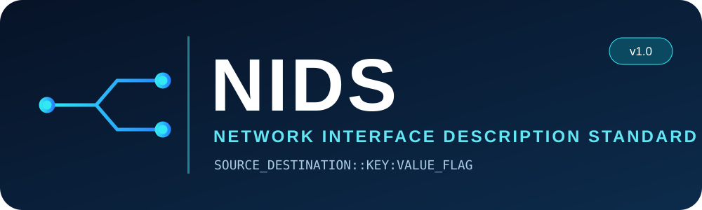

<p align="center"></p>

# Network Interface Description Standard (NIDS)

Vendor-neutral conventions for human-readable and machine-parseable interface descriptions across network equipment.

## Syntax

```text
SOURCE_DESTINATION_LAYER_DEVICE-FUNCTION_DESCRIPTION::KEY:VALUE_KEY:VALUE_FLAG
```

Legacy fields are positional. One nonempty legacy field means destination; two mean source and destination. Explicit empty positions are preserved, e.g. `source_destination__router_description` omits layer. Layer is never defaulted. The first `::` starts metadata. Metadata uses underscores between arguments, colons after keys, single-quoted literal strings (apostrophes doubled), bracketed IPv6, comma lists, and inclusive numeric ranges. Parsing is forgiving of empty list members and incomplete quotes; provisioning must validate values independently.

### Examples

```text
OLT-1::SERVICE-VLAN:151_CUSTOMER-VLAN:100_DHCP-OPTION82
source_destination__router_description::VLAN:1,2,,3_DESC:'Customer''s Link'
CORE-1_EDGE-1_L3_ROUTER-UPLINK::IP:[2001:db8::1]
```

This is an initial reference draft. See future specification and conformance tests before treating it as a production provisioning contract.
